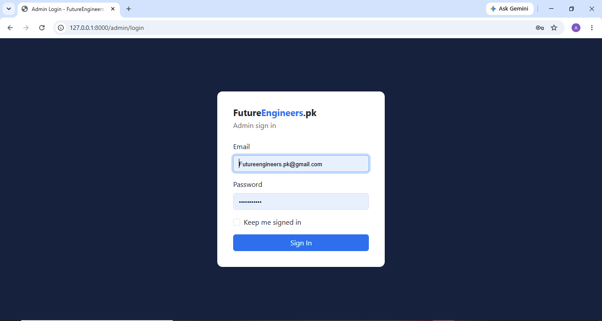
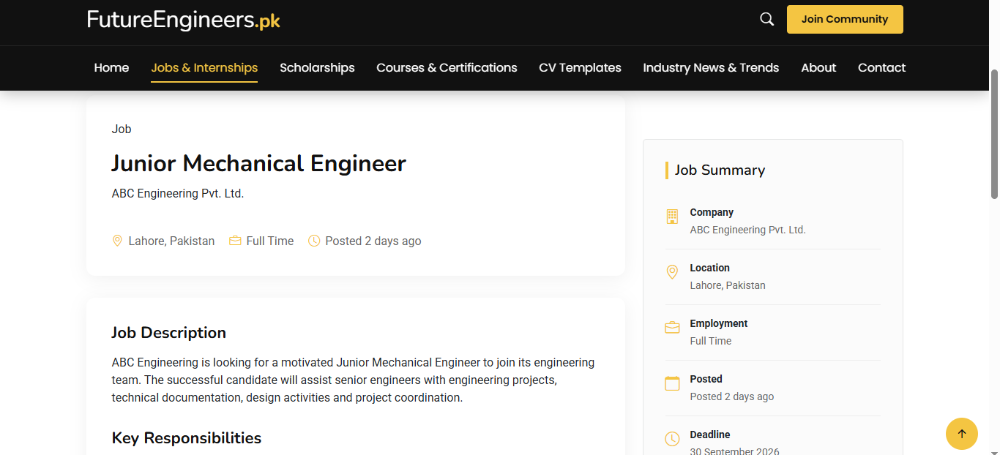
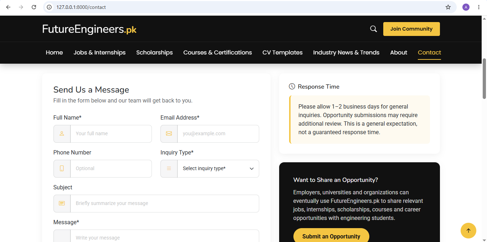
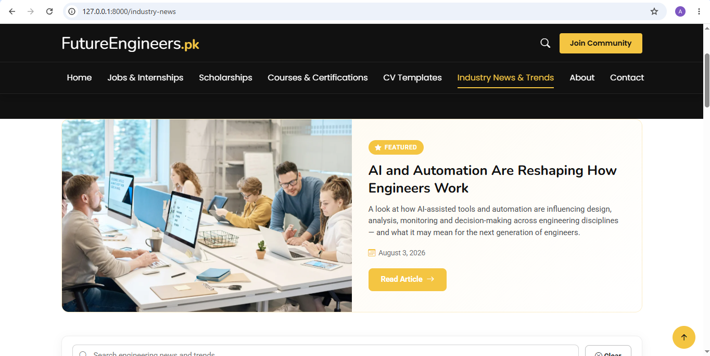

# FutureEngineers.pk — Engineering Website

A web development project built to present an engineering-focused organization through a structured, user-friendly website.

## 📸 Project Screenshots

Screenshots of the website are available in the [`screenshots`](./screenshots/) folder.

### Homepage

### Website Preview

## 🛠️ Technologies

- Laravel
- PHP
- MySQL
- HTML
- CSS
- JavaScript

## ✨ Project Overview

FutureEngineers.pk is a website project focused on presenting information through a clean website interface. The project uses Laravel for its backend structure and MySQL for database integration.

## 🎯 Project Purpose

This project demonstrates practical experience with web application development, website structure, interface design, and Laravel-based development.

## 👩‍💻 Developer

**Saba Ashraf**

BBIT Student | Web Development & AI Enthusiast

GitHub: [@sabaashraf27](https://github.com/sabaashraf27)

---

*This repository is
